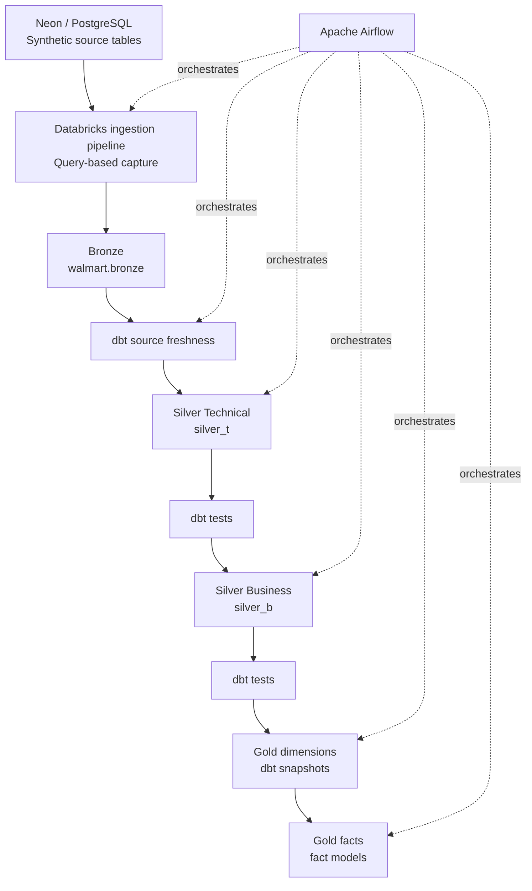

# Walmart Data Engineering Project

End-to-end data engineering laboratory built around a fictional Walmart dataset. The project demonstrates ingestion, layered transformations, data quality checks, historical tracking, and orchestration.

> **Status:** End-to-end Airflow DAG executed successfully in the development environment.
>
> **Data note:** The source data is synthetic and stored in Neon (PostgreSQL). This is a learning project, not Walmart's real data platform.

## Goals

- Build an end-to-end data pipeline from a PostgreSQL source to an analytics-ready Gold layer.
- Apply the Medallion Architecture to separate raw, technical, business, and analytical responsibilities.
- Use dbt for SQL transformations, tests, source freshness checks, and snapshots.
- Orchestrate the pipeline with Apache Airflow and trigger a Databricks job through the Databricks SDK.
- Practice troubleshooting pipeline failures and validating data quality.

## Architecture



### Pipeline flow

The Airflow DAG `orchestrate` runs these steps in sequence:

1. **Ingest:** trigger the Databricks ingestion job and wait for its final state.
2. **Clean generated dbt artifacts:** remove the local `target` and `logs` directories.
3. **Freshness:** run the dbt source freshness check.
4. **Silver Technical:** execute `dbt run --select silver_t`, followed by its tests.
5. **Silver Business:** execute `dbt run --select silver_b`, followed by its tests.
6. **Gold dimensions:** execute dbt snapshots to maintain historical versions of selected entities.
7. **Gold facts:** build fact models under `models/gold/fact`.

The DAG is configured with a daily schedule. The current orchestration uses an explicit dependency chain, so a failed task prevents downstream tasks from running.

## Data layers

### Bronze — `walmart.bronze`

The ingestion destination for source tables with minimal transformation.

Tables:
- `customers`
- `employees`
- `order_items`
- `orders`
- `products`
- `stores`

The source is Neon/PostgreSQL. The Databricks ingestion pipeline is configured for **query-based capture** with `updated_timestamp` as the cursor column for incremental extraction. This should not be described as native log-based CDC: query-based capture uses a cursor/query strategy rather than consuming the database transaction log.

### Silver Technical — `silver_t`

Technical preparation and standardization of source entities, including timestamp and processing metadata.

dbt models:
- `customers_t`
- `employees_t`
- `order_items_t`
- `orders_t`
- `products_t`
- `stores_t`

### Silver Business — `silver_b`

Business-oriented model(s) that combine the technical entities for downstream analytical use. The current project includes `obt_b`, an One Big Table-style model.

When designing joins, validate the grain and cardinality of each relationship. A successful SQL execution does not by itself prove that joins have not duplicated business measures.

### Gold

The analytics-facing layer includes:
- **Snapshots / dimensions:** dbt snapshots track historical changes for customer, employee, order, product, and store entities.
- **Facts:** models under `models/gold/fact`, including `fact_orders`.

The `dim_orders` snapshot was rebuilt after a Delta MERGE failure caused by multiple source rows matching the same target row. The pipeline was subsequently rerun successfully. Snapshot history and current-record uniqueness should still be validated as part of ongoing data-quality checks.

## Freshness and synthetic data

dbt source freshness is configured in `models/source/sources.yml` using `updated_timestamp`. Freshness evaluates the age of the most recent value in that field against configured warning/error thresholds.

Because this is a lab with synthetic records, source timestamps do not necessarily advance naturally. Synthetic updates were used to exercise freshness behavior and validate orchestration. In a production system, freshness thresholds should reflect the source's expected update cadence and business SLA; a successful Airflow run alone does not prove that source data is fresh.

## Data quality

The project uses dbt tests and operational checks to validate data. Areas covered or being validated include:
- uniqueness and non-null constraints;
- source freshness;
- model execution success;
- snapshot history and current versions;
- join cardinality and business grain.

## Technology stack

| Technology | Responsibility |
|---|---|
| Neon / PostgreSQL | Synthetic transactional source |
| Databricks | Ingestion pipeline and data processing platform |
| dbt | SQL transformations, tests, source freshness, and snapshots |
| Apache Airflow 3 | Workflow orchestration and dependency management |
| Databricks SDK for Python | Triggering and monitoring the Databricks job from Airflow |
| Git / GitHub | Version control and project documentation |

## Repository structure

```text
walmart_project_dbt/
├── walmart_project/
│   ├── analyses/
│   ├── macros/
│   ├── models/
│   │   ├── gold/
│   │   │   ├── ephemeral/
│   │   │   └── fact/
│   │   ├── silver_b/
│   │   ├── silver_t/
│   │   └── source/
│   ├── seeds/
│   ├── snapshots/
│   ├── tests/
│   ├── dbt_project.yml
│   └── profiles.yml
├── dags/
│   └── orchestrate.py
├── .gitignore
├── pyproject.toml
├── README.md
└── uv.lock
```

The exact local directory layout may vary depending on how the Airflow and dbt folders are mounted in the development environment.

## Running locally

This repository depends on external services and credentials; configure them locally before running the workflow.

1. Configure the dbt profile for your Databricks SQL endpoint and catalog/schema access.
2. Configure Airflow and the required Databricks connection/environment variables.
3. Ensure the Databricks ingestion job and pipeline are available.
4. Validate the dbt project from its directory:
   ```bash
   dbt debug
   dbt source freshness
   dbt run --select silver_t
   dbt test --select silver_t
   dbt run --select silver_b
   dbt test --select silver_b
   dbt snapshot
   dbt run --select path:models/gold/fact
   ```
5. Trigger the Airflow DAG `orchestrate` and review each task's logs.

**Security:** never commit `.env` files, access tokens, passwords, private connection strings, or production data. Use environment variables or a secrets manager. Do not commit generated dbt `target/` or `logs/` artifacts.

## Learning outcomes

This project has provided hands-on practice with layered data architecture, incremental extraction, freshness monitoring, dbt testing and snapshots, Airflow orchestration, and debugging failures across a multi-tool data pipeline.
